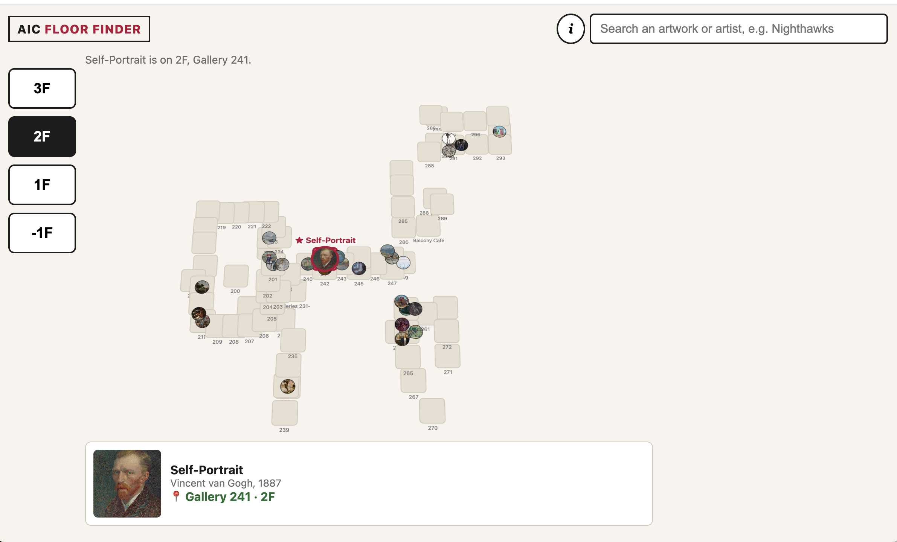
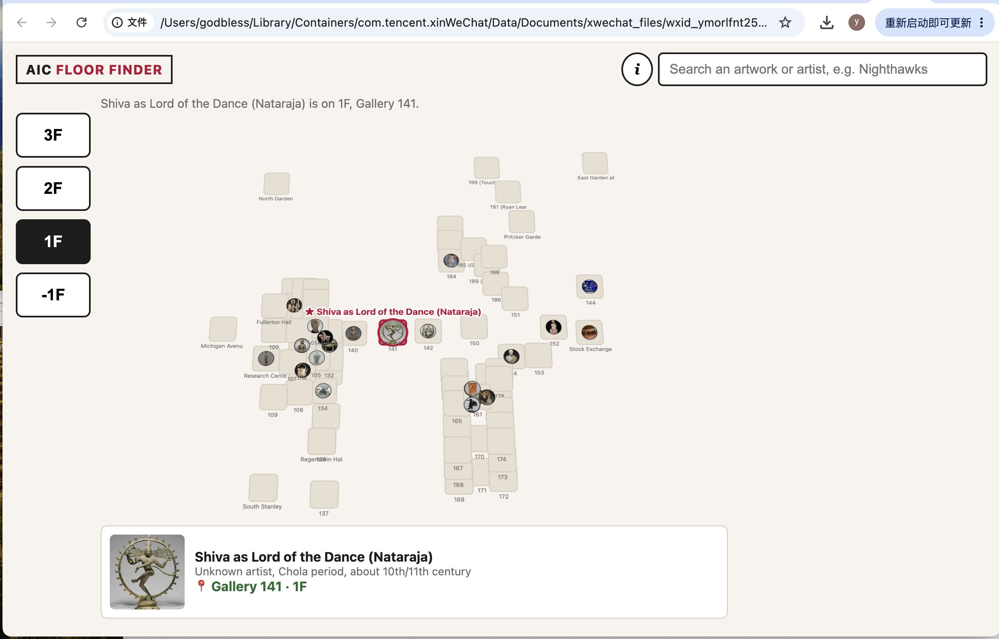

# Day 1 "before" snapshot

Write your own, even if you worked in a pair. Keep it: we come back to it at mid-quarter (Week 6) and at the end (Week 11). Your prompts go in `ai_log.md`, not here.

**Name:** Yuyao Sun
**Partner (if any):** Matt Shi

## Before we prompted

### 1. Who is it for, and what do they want to do?

It's for visitors to the Art Institute of Chicago who want to navigate the museum and locate exact artworks or exhibitions clearly. 

**"The user can..." sentences:**
1. The user can scroll through the floor index and select a floor to view its floor plan.
2. The user can search for a specific artwork and see which floor it is on.
3. The user can click an artwork to jump to its location on the floor plan.

### 2. Our sketch

Put the photo in this `hw0` folder, then change the filename below to match:

### 3. Our prediction

We expected the app would show different museum floors, let users search for artworks, and jump to the correct floor when an artwork is selected.

## What we got

### 4. What the AI made

Put the screenshot in this `hw0` folder, then change the filename below to match:

### 5. Sketch vs. app

- **Matches our sketch:** It has the floor buttons on the left, a search bar at the top, and a floor plan in the middle.

- **Different from our sketch:** The final floor plan has more details, like gallery numbers and artwork images.

- **The AI decided** (something we never said): It added the “AIC FLOOR FINDER” title, some colors, and an artwork card at the bottom.

### 6. What did I keep, change, or reject, and why?

I kept the floor buttons and search bar because they made the app easy to navigate. I changed the floor plan to show more gallery and artwork details so users could find locations more easily.

### 7. Explain back

Pick one part of the code. In your own words, what does it do?

The floor selection part changes the map when the user clicks a floor button. It only shows the galleries and artworks that belong to that floor.

## Looking ahead

### 8. What does it do? Does it work? What broke?

The app helps visitors find artworks and see which floor and gallery they are on. Most of it works, including searching and switching floors. The floor plan is a little crowded in some areas, so some labels overlap.

### 9. How much do I understand about how it works? (0–100%)

**My number:** 80%

**Why that number:** I was able to use Claude Code and my prompts to build a small interactive product in a short amount of time. I understand most of the main features, but there is still about 20% that I can improve and learn more about.

### 10. What would I need to know to tell whether it's *well designed or well built*?

I would need to know if users can easily search for artworks, understand the floor plan, and find the location they are looking for.

### 11. What do I hope to be able to do by week 10?

I hope I can understand more of the code behind the product and use AI to build interactive products with more control and less help.
