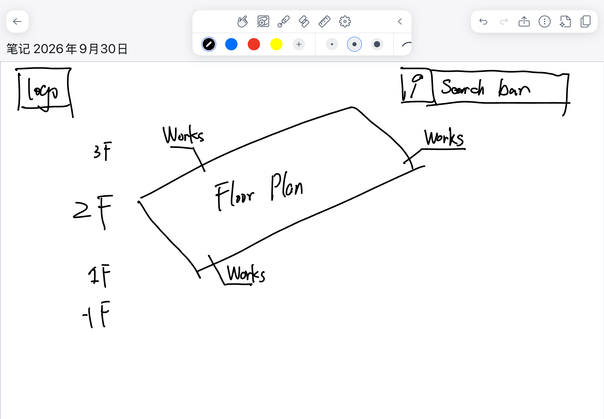

# Day 1 "before" snapshot

Write your own, even if you worked in a pair. Keep it: we come back to it at mid-quarter (Week 6) and at the end (Week 11). Your prompts go in `ai_log.md`, not here.

**Name:** Yuyao Sun
**Partner (if any):** Matt Shi

## Before we prompted

### 1. Who is it for, and what do they want to do?

It's for visitors to the Art Institute of Chicago who want to navigate the museum and locate exact artworks or exhibitions clearly. 

**"The user can..." sentences:**
1. The user can scroll through the floor index and select a floor to view its floor plan.
2. The user can search for a specific artwork and see which floor it is on.
3. The user can click an artwork to jump to its location on the floor plan.

### 2. Our sketch

Put the photo in this `hw0` folder, then change the filename below to match:

### 3. Our prediction

We expected the app would show different museum floors, let users search for artworks, and jump to the correct floor when an artwork is selected.

## What we got

### 4. What the AI made

Put the screenshot in this `hw0` folder, then change the filename below to match:

### 5. Sketch vs. app

- **Matches our sketch:**
- **Different from our sketch:**
- **The AI decided** (something we never said):

### 6. What did I keep, change, or reject, and why?

### 7. Explain back

Pick one part of the code. In your own words, what does it do?

## Looking ahead

### 8. What does it do? Does it work? What broke?

### 9. How much do I understand about how it works? (0–100%)

**My number:**

**Why that number:**

### 10. What would I need to know to tell whether it's *well designed or well built*?

### 11. What do I hope to be able to do by week 10?

