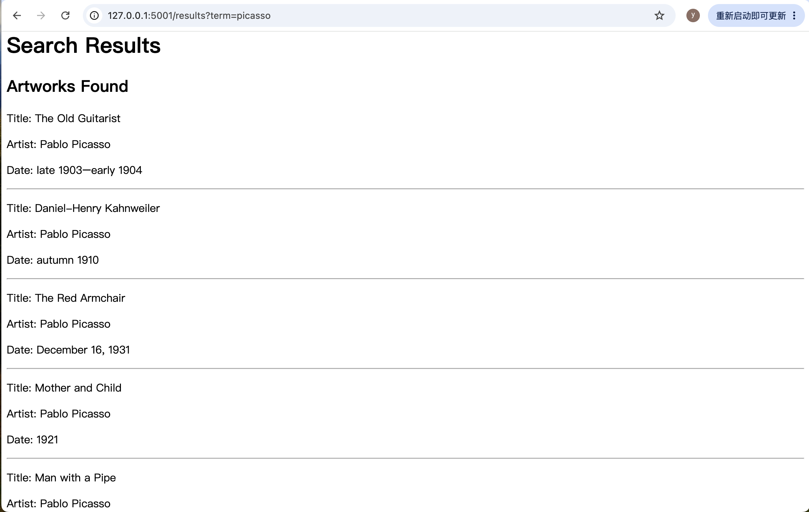

# HW4 Art Search Web App

## Who is it for?

This web app is designed for people who want to quickly search for artworks by artist name using the Art Institute of Chicago API.

## How to Run

1. Install Flask and Requests if needed: `pip install flask requests`
2. Run the app: `flask --app app run --debug --port 5001`
3. Open `http://127.0.0.1:5001` in a browser.
4. Enter an artist's name, such as "monet" or "picasso", and click Search to view the artworks.

## a screenshot

