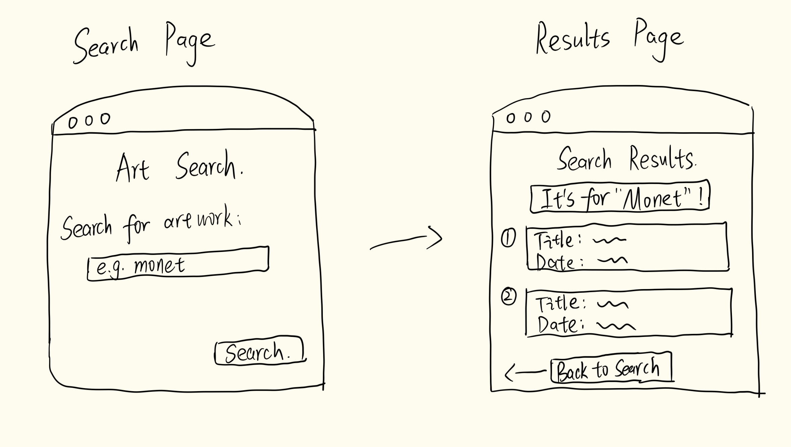

# HW4 Plan: Art Search Web App

## 1. Screen Sketches

## 2. Data needed from the API

I will reuse the Art Institute of Chicago API from HW3.

API endpoint:
https://api.artic.edu/api/v1/artworks/search

In that case, the results page will include these data:

- `title`: The name of the artwork.
- `artist_title`: The artist's name.
- `artist_display`: Additional information about the artist.
- `date_display`: The date of the artwork.

I will use the search term entered by the users to request specific matching artworks.
If a field is missing, I will display a helpful fallback message instead of showing a blank value.

## 3. Function and Route Specifications

### Home Route (/)

Input: None.

Output: Displays the search page with a text input, such as an artist's name and a Search button.

Checks:
1. Open the homepage and confirm the search form appears.
2. Use the Tab key to move between the input and Search button.

### Results Route (/results)

Input: A search term entered by the user.

Output: Displays matching artworks or a helpful message.

Checks:
1. Search "monet" and confirm artwork results appear.
2. Submit an empty search and confirm a helpful message appears.
3. Search a nonsense term and check the no-results message.

### search_art(term) Function

Input: A search term entered by the user, such as "monet".

Output: A list of matching artworks from the Art Institute of Chicago API, or None if the API request fails.

Checks:
1. Search "monet" and confirm the API returns artwork data.
2. Temporarily use an invalid API URL and confirm a helpful error message appears.
3. Check that artworks with missing information display fallback text.