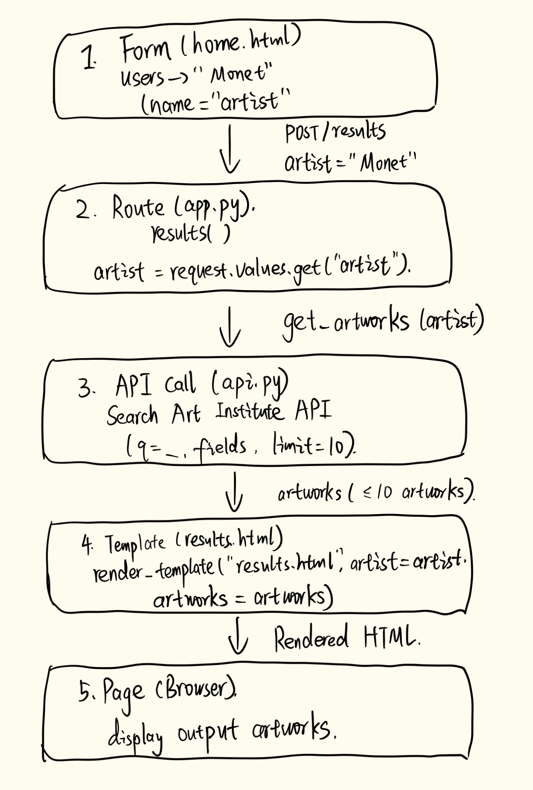

1. AI Stage

My AI use followed the stage listed at the top of the assignment: Stage 4.

AI tool used: ChatGPT.

2. Full AI Chat Transcripts

ok了
很好！现在我们继续 Step 4 的第二部分：What it got wrong（AI 哪里判断得不准确）。

老师要求你不仅记录 AI 发现的问题，还要批判性地检查 AI 的回答。

我们可以指出一个需要纠正的地方
刚才 AI Review 提到：

api.py 第 10 行没有区分网络超时和连接失败。

这个说法需要更准确地理解：

requests.get(..., timeout=10) 已经设置了超时限制。

app.py 的 except Exception 也能够捕获这些请求异常。

因此，不能说程序完全没有处理网络错误。

真正的问题是程序没有针对不同错误提供具体、友好的提示。

你可以在 findings.md 中写：

The AI review suggested that the app was missing error handling for API requests. However, app.py already uses try/except to catch request failures, and api.py sets a 10-second timeout. The app does handle these errors, but it could provide clearer messages for different types of failures.

这体现了你没有盲目接受 AI 的建议，而是回头检查了实际代码。

现在把这段内容放到 What it got wrong: 下面，按 ⌘ + S 保存。

保存后告诉我，我们继续 Step 4 的最后一部分：回答你提出的两个问题，并用自己的英文总结。

ok了
很好！现在我们进入 Step 4 的最后一部分：回答你在 Step 2 提出的两个问题。

老师要求你先向 AI 提问，再用自己的话（in your own words）写出答案。

Question 1
Why does api.py use response.raise_for_status() after making the API request? What happens if the API request fails?

AI 的解释：

response.raise_for_status() 用来检查 API 返回的 HTTP 状态码。

如果请求成功（例如 HTTP 200），程序继续执行。

如果服务器返回 HTTP 404 或 500，它会抛出异常。

app.py 中的 try/except 会捕获异常，并在首页显示错误信息。

如果发生连接失败或超时，requests.get() 本身也可能抛出异常。

你可以用自己的话简化为：

It checks whether the API request returned an HTTP error. If it did, an exception is raised and app.py catches it to display an error message.

Question 2
Why does the /results route allow both GET and POST methods, even though the search form only uses POST?

AI 的解释：

在 Flask 中，GET 和 POST 是两种 HTTP 请求方式。

GET：通常用于获取页面或通过 URL 参数搜索，例如 /results?artist=Monet。

POST：通常用于提交表单数据。

你的 home.html 使用 POST 提交搜索。

但 app.py 同时允许 GET 和 POST，因此用户也可以直接通过带参数的 URL 访问搜索结果。

request.values.get("artist") 可以从 URL 查询参数或 POST 表单数据中读取 artist。

你可以用自己的话简化为：

The route accepts both GET and POST so users can search through either a URL query or the form. The form currently uses POST, but GET requests also work because app.py uses request.values.

现在填写 findings.md
在：

Answers to my two questions, in my own words:

下面根据你的理解写出两段英文。上面的英文是参考，不必逐字照抄，尤其老师要求使用自己的话。

完成后，Step 4 的三个部分就齐了：

What it found that I missed

What it got wrong

Answers to my two questions

按 ⌘ + S 保存。

接下来是 Step 5：My Fix（4 分）。这一部分非常重要：必须先进行第一次 Git Commit，再修改代码，然后测试并进行第二次 Commit。 我们会一步一步操作，避免遗漏。

# HW5 findings

## 1. Drawing: one search for "Monet"

## 2. Two questions about the code
1. Why does api.py use response.raise_for_status() after making the API request? What happens if the API request fails?
2. Why does the /results route allow both GET and POST methods, even though the search form only uses POST?

## 3. Checks (4 or more, at least 2 as pytest tests)
| # | Check | Pass or fail |
|---|---|---|
| 1 | Homepage loads and displays the search form (pytest) | Pass |
| 2 | Empty artist input displays an error message (pytest) | Pass |
| 3 | Searching "Monet" displays artwork titles, dates, and images (manual) | Fail — titles and dates display correctly, but artwork images fail to load. |
| 4 | Searching a nonexistent artist displays "No results found" (manual) | Fail — unrelated artworks appear instead. |

## 4. AI review
What it found that I missed: 
## The AI found some problems that I did not test for. In app.py, lines 16–17 display raw exception messages to users, which may reveal internal information. Line 21 also enables debug mode, which could create security risks if the app were deployed publicly. In api.py, line 12 does not verify that the returned data is actually a list.
What it got wrong:
## The AI review suggested that the app was missing error handling for API requests. However, app.py already uses try/except to catch request failures, and api.py sets a 10-second timeout. The app does handle these errors, but it could provide clearer messages for different types of failures.
Answers to my two questions, in my own words:
## Q1: It checks whether the API request returned an HTTP error. If it did, an exception is raised and app.py catches it to display an error message.
## Q2: The route accepts both GET and POST so users can search through either a URL query or the form. The form currently uses POST, but GET requests also work because app.py uses request.values.

## 5. My fix
What was wrong:
What I changed:
How I checked it works:
Commit before: (hash)  Commit after: (hash)

## 6. Can we ship it? (100–150 words)
Yes or no, and why:

One thing my HW4 does better:
One thing the AI's app does better:

AI use goes in `ai_use.md` (the five points on the AI Use Card).

…
我检查了你最新的 findings.md。Step 1–4 的内容基本齐全，可以准备进入 Step 5（My Fix，4 分）了。

不过，为了尽量避免格式问题导致扣分，我建议先修改一个地方。

1. Step 4 的 Markdown 格式需要调整
你现在写的是：

What it found that I missed:
## The AI found some problems...
## 在 Markdown 中代表二级标题，不应该放在普通回答前面。

建议改成：

## 4. AI review

**What it found that I missed:**

The AI found some problems that I did not test for...

**What it got wrong:**

The AI review suggested that the app was missing error handling...

**Answers to my two questions, in my own words:**

Q1: It checks whether the API request returned an HTTP error...

Q2: The route accepts both GET and POST...
保留你原来的英文内容，只需要删除回答前面的 ##。

另外，你粘贴的内容里有 **# HW5 findings** 和 \| 等字符。请用 VS Code 的 Markdown Preview 确认标题和表格能正常显示。如果这些符号真的存在于文件中，也要修正。

2. Step 4 的内容是否符合要求？
要求

检查结果

AI Review app.py 和 api.py

 已完成

指出代码位置

 已包含行号

What it found that I missed

 已填写

What it got wrong

 已填写

回答两个问题

 已填写

有一个内容上的小提醒：你写的 What it got wrong 更准确地说是在澄清 AI 对错误处理的描述，而不是证明 AI 完全判断错误。这样写可以，但不要夸大。

3. 下一步：Step 5 — My Fix
我们已经通过测试发现两个问题：

搜索 Monet 时，图片无法加载。

搜索不存在的艺术家时，出现不相关的作品。

我更推荐优先考虑修复无关搜索结果的问题，因为它可能直接影响搜索功能的正确性。不过，需要先确认 API 返回的数据，再决定具体改法。

重要：修改代码之前，必须先创建 Git Commit。

现在先按 ⌘ + S 保存所有文件。

然后在 VS Code Terminal 输入：

git status

把输出截图发给我。

我会先确认哪些文件应该加入第一次 Commit，特别是你当前有不少标记为 U 的文件。我们要避免把 __pycache__、虚拟环境等不需要的文件提交进去。

暂时不要修改 app.py 或 api.py。

# HW5 findings

## 1. Drawing: one search for "Monet"

## 2. Two questions about the code
1. Why does api.py use response.raise_for_status() after making the API request? What happens if the API request fails?
2. Why does the /results route allow both GET and POST methods, even though the search form only uses POST?

## 3. Checks (4 or more, at least 2 as pytest tests)
| # | Check | Pass or fail |
|---|---|---|
| 1 | Homepage loads and displays the search form (pytest) | Pass |
| 2 | Empty artist input displays an error message (pytest) | Pass |
| 3 | Searching "Monet" displays artwork titles, dates, and images (manual) | Fail — titles and dates display correctly, but artwork images fail to load. |
| 4 | Searching a nonexistent artist displays "No results found" (manual) | Fail — unrelated artworks appear instead. |

## 4. AI review
What it found that I missed: 

The AI found some problems that I did not test for. In app.py, lines 16–17 display raw exception messages to users, which may reveal internal information. Line 21 also enables debug mode, which could create security risks if the app were deployed publicly. In api.py, line 12 does not verify that the returned data is actually a list.

What it got wrong:

The AI review suggested that the app was missing error handling for API requests. However, app.py already uses try/except to catch request failures, and api.py sets a 10-second timeout. The app does handle these errors, but it could provide clearer messages for different types of failures.

Answers to my two questions, in my own words:
## Q1: It checks whether the API request returned an HTTP error. If it did, an exception is raised and app.py catches it to display an error message.
## Q2: The route accepts both GET and POST so users can search through either a URL query or the form. The form currently uses POST, but GET requests also work because app.py uses request.values.

## 5. My fix
What was wrong:
What I changed:
How I checked it works:
Commit before: (hash)  Commit after: (hash)

## 6. Can we ship it? (100–150 words)
Yes or no, and why:

One thing my HW4 does better:
One thing the AI's app does better:

AI use goes in `ai_use.md` (the five points on the AI Use Card).

…
这次比上一版好多了！Step 4 的主要内容已经完整，可以进入 Step 5。

不过还有两个小地方建议调整。

1. Q1 和 Q2 不需要 ##
你现在写的是：

**## Q1: It checks whether...**
**## Q2: The route accepts...**
建议改成普通段落：

**Q1:** It checks whether the API request returned an HTTP error. If it did, an exception is raised and app.py catches it to display an error message.

**Q2:** The route accepts both GET and POST so users can search through either a URL query or the form. The form currently uses POST, but GET requests also work because app.py uses request.values.
这样更符合 findings.md 的排版。

2. 确认图片链接和标题格式
你粘贴的内容里有：

**# HW5 findings**
![Search flow diagram for Monet]\(search_flow\.png)
在实际的 findings.md 中应该是：

# HW5 findings

## 1. Drawing: one search for "Monet"

如果这些反斜杠只是复制到聊天时自动添加的，就不用修改。

I used ChatGPT to help me understand the Flask application, review the code, investigate bugs, work through testing and Git commands, and improve my written explanations.

3. AI Contributions

**Steps 2–3 — Code understanding and testing**

ChatGPT helped explain Flask code, and troubleshoot test execution. I ran the checks and documented their results in findings.md.

**Step 4 — AI review**

ChatGPT reviewed app.py and api.py for potential bugs, error handling, accessibility, and security problems. I evaluated its suggestions and answered my two code questions in findings.md.

**Step 5 — Bug fix**

ChatGPT assisted with modifying get_artworks() in api.py to filter unrelated artworks using artist_title. I inspected the change and verified it through browser searches and pytest.

**Step 6 — Written evaluation**

ChatGPT helped revise my ship-it response and HW4 comparison in findings.md.

4. Understanding and Verification

The Flask app uses app.py to handle requests and api.py to retrieve artwork data. The results template displays the returned artworks.

I verified the filtering change by searching for "Monet" and a nonexistent artist. Both pytest tests passed. However, the images still failed to load during manual testing.

5. Reflection

ChatGPT helped me understand the application and investigate unexpected search results. I learned that API responses may contain unrelated artworks and that filtering results can improve search accuracy.

I also noticed that AI reviews are not always correct. For example, the original application already had basic exception handling and a timeout. I checked the code and ran tests rather than relying only on the AI's suggestions.

