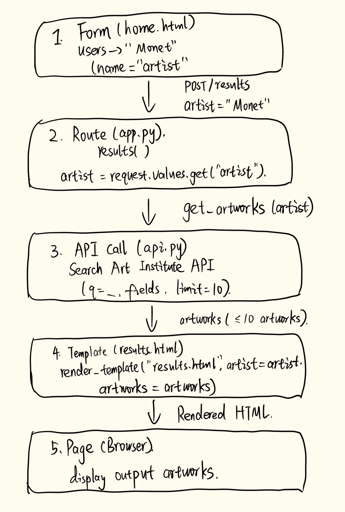

# HW5 findings

## 1. Drawing: one search for "Monet"

## 2. Two questions about the code
1. Why does api.py use response.raise_for_status() after making the API request? What happens if the API request fails?
2. Why does the /results route allow both GET and POST methods, even though the search form only uses POST?

## 3. Checks (4 or more, at least 2 as pytest tests)
| # | Check | Pass or fail |
|---|---|---|
| 1 | Homepage loads and displays the search form (pytest) | Pass |
| 2 | Empty artist input displays an error message (pytest) | Pass |
| 3 | Searching "Monet" displays artwork titles, dates, and images (manual) | Fail — titles and dates display correctly, but artwork images fail to load. |
| 4 | Searching a nonexistent artist displays "No results found" (manual) | Fail — unrelated artworks appear instead. |

## 4. AI review
What it found that I missed: 

The AI found some problems that I did not test for. In app.py, lines 16–17 display raw exception messages to users, which may reveal internal information. Line 21 also enables debug mode, which could create security risks if the app were deployed publicly. In api.py, line 12 does not verify that the returned data is actually a list.

What it got wrong:

The AI review suggested that the app was missing error handling for API requests. However, app.py already uses try/except to catch request failures, and api.py sets a 10-second timeout. The app does handle these errors, but it could provide clearer messages for different types of failures.

Answers to my two questions, in my own words:
**Q1:** It checks whether the API request returned an HTTP error. If it did, an exception is raised and app.py catches it to display an error message.
**Q2:** The route accepts both GET and POST so users can search through either a URL query or the form. The form currently uses POST, but GET requests also work because app.py uses request.values.

## 5. My fix
**What was wrong:** The app displayed unrelated artworks when I searched for a nonexistent artist.
**What I changed:** I updated api.py to filter the API results by artist_title. The code now keeps only artworks whose artist name contains the search term, ignoring capitalization.
**How I checked it works:** I searched for xyznonexistentartist987654 again, and the app correctly displayed "No results found." I also searched for "Monet" and confirmed that matching artworks still appeared. I reran pytest, and both tests passed.
**Commit before:** 5fd1a65 
**Commit after:** (hash)

## 6. Can we ship it? (100–150 words)
Yes or no, and why:

One thing my HW4 does better:
One thing the AI's app does better:

AI use goes in `ai_use.md` (the five points on the AI Use Card).
